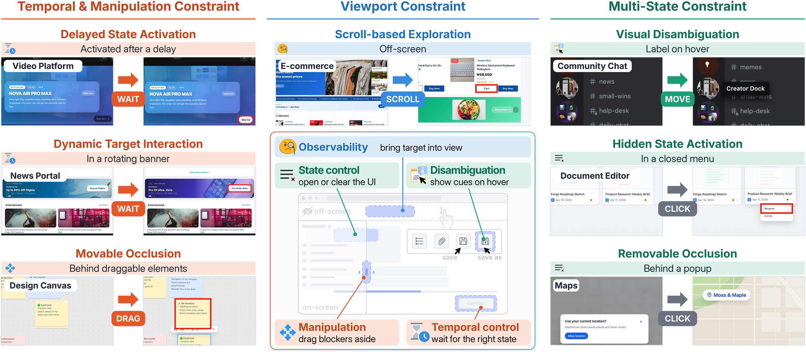

# IGG: A Benchmark for Interactive GUI Grounding under Visibility Constraints (EMNLP 2026)

### [Project Page](https://igg-bench.github.io/) | Paper (coming soon)

Official benchmark and evaluation code for **IGG**, accepted at **EMNLP 2026**.



---

## Abstract

GUI grounding benchmarks ask whether an agent can localize a target that is
already visible in a static screenshot. Real interfaces often violate this
assumption: a target may be off-screen, appear only after a state change or
hover, remain occluded, or become actionable after a delay. This leaves the
ability to recover target visibility unevaluated.

We introduce **Interactive GUI Grounding (IGG)**, a benchmark in which an agent
must first make the target visible through interaction and then click it. IGG
contains 601 tasks across 16 controllable GUI environments and seven
visibility-constraint sub-types, with a compact action space of scrolling,
moving, dragging, waiting, and clicking. In our human study, participants
achieve 94.6% accuracy, while GPT-5.5 reaches 79.4% and the strongest evaluated
open-source VLM reaches only 31.6%.

---

## Benchmark

| Constraint type | Sub-type | Tasks |
|---|---|---:|
| CT1 Viewport | 1-1 Scroll-based Exploration | 130 |
| CT2 Multi-State | 2-1 Visual Disambiguation | 73 |
| | 2-2 Hidden State Activation | 82 |
| | 2-3 Removable Occlusion | 43 |
| CT3 Temporal & Manipulation | 3-1 Delayed State Activation | 53 |
| | 3-2 Dynamic Target Interaction | 48 |
| | 3-3 Movable Occlusion | 52 |
| **Total** | | **481** |

This release contains **481 of the 601 tasks**. The remaining 120 tasks form
the held-out validation set used in our training experiments and are kept
private to prevent contamination.

A task succeeds when the agent clicks the target element within **8 actions**.

<details>
<summary><b>Environments (16)</b></summary>

| App | Category | Tasks | Port |
|---|---|---:|---:|
| `chirp` | Social Feed | 23 | 3215 |
| `dayplan` | Planner | 23 | 3209 |
| `devhub` | Developer Hub | 30 | 3208 |
| `devpad` | Code Editor | 23 | 3213 |
| `discord` | Community Chat | 39 | 3205 |
| `docs` | Document Editor | 34 | 3204 |
| `figma` | Design Canvas | 35 | 3202 |
| `gridly` | Spreadsheet | 34 | 3211 |
| `mailo` | Email Client | 36 | 3207 |
| `never` | News Portal | 26 | 3201 |
| `pagely` | Workspace Pages | 31 | 3214 |
| `reelify` | Streaming Service | 33 | 3217 |
| `shopping` | E-commerce | 23 | 3100 |
| `wavr` | Music Player | 41 | 3216 |
| `wayfind` | Maps | 26 | 3212 |
| `youtube` | Video Platform | 24 | 3203 |

The apps are self-contained mockups with synthetic content and are not
connected to any real service. Each is a Next.js app under `apps/<name>/` and
can be started on its own with `npm run dev:<name>:port<port>`.

</details>

---

## Environment Setup

Requires **Node.js 20+**. Tested on macOS, Linux, and Windows.

```bash
git clone https://github.com/kaist-ami/IGG.git && cd IGG
npm install
npx playwright install chromium
```

Check the setup by replaying the annotated ground-truth trajectories. All 481
tasks should pass:

```bash
npm run verify        # = node eval/run.mjs --gold --name gold-replay
```

The runner starts each app (`next dev`) on its port when it is not already
running. To keep all 16 apps up across evaluations, run `npm run dev:all` once.

---

## Evaluation

The evaluator talks to the model over a small HTTP protocol
([Adding your own model](#adding-your-own-model)). Start a model server, then
point the evaluator at it:

```bash
# 1. Model server (GPU machine)
pip install -r servers/requirements.txt
CUDA_VISIBLE_DEVICES=0 bash servers/launch_hf_model.sh gui-owl15-8b 8012

# 2. Benchmark
node eval/run.mjs --agent-url http://localhost:8012 --name gui-owl15-8b
```

| Option | Default | Description |
|---|---|---|
| `--apps a,b,c` | all 16 | Subset of apps |
| `--dataset main\|hint` | `main` | Goal-only instructions, or the procedural-hint variant |
| `--task-ids id1,id2` | | Run specific tasks |
| `--max-steps N` | `8` | Action budget per task |
| `--retry-limit N` | `0` | HTTP retries on 429/5xx from the model server |

### Metrics

| Metric | Description |
|---|---|
| **GA** (Grounding Accuracy) ↑ | Fraction of tasks where the agent clicks the target within the budget |
| **AC** (Action Cost) ↓ | Mean number of actions until success or budget exhaustion |
| **RER** (Reference Efficiency Ratio) ↑ | Mean of \|ground-truth trajectory\| / \|agent trajectory\| over successful tasks |
| **TT** (Total Time) ↓ | Mean wall-clock time per task (depends on serving hardware) |

**Protocol used in the paper:** viewport-only screenshots at 1440×900, 8
actions, and greedy decoding.

### Provided model servers

All servers implement the same `/act` protocol and share the prompt in
`servers/prompts/igg_prompt.py` (v1.0).

| Server | Models | Launch |
|---|---|---|
| `qwen25vl_server.py` | Qwen2.5-VL-7B-Instruct | `launch_hf_model.sh qwen25vl` |
| `qwen3vl_server.py` | Qwen3-VL-8B-Instruct | `launch_hf_model.sh qwen3vl` |
| `gui_owl15_server.py` | GUI-Owl-1.5 (8B/32B), KV-Ground-8B, Indeed-UI-8B, UI-Venus-1.5-8B, MAI-UI-8B, Holo2-8B, Holo3-35B-A3B, EvoCUA (8B/32B) | `launch_hf_model.sh <name>` |
| `opencua_vllm_server.py` | OpenCUA-72B (via vLLM) | `launch_opencua.sh` |
| `openai_server.py` | GPT-5.5 (needs `OPENAI_API_KEY`) | `python servers/openai_server.py --port 8015` |
| `claude_server.py` | Claude (needs `ANTHROPIC_API_KEY`) | `python servers/claude_server.py --port 8013` |

`launch_hf_model.sh` holds the model IDs, coordinate scales, and token limits
used for the reported results.

---

## Adding your own model

Implement two endpoints:

```
GET  /health  ->  {"ok": true, "modelId": "...", "promptVersion": "..."}

POST /act
  request:  {"instruction": str,
             "screenshotBase64": str,          # PNG, 1440x900 viewport
             "trace": [action, ...],           # actions taken so far
             "stepIndex": int}
  response: {"ok": true, "action": action, "rawText": str}
```

where `action` is one of:

```json
{"type": "click",  "x": 512, "y": 340}
{"type": "move",   "x": 300, "y": 220}
{"type": "scroll", "x": 700, "y": 500, "dy": 640}
{"type": "drag",   "startX": 100, "startY": 200, "endX": 400, "endY": 200}
{"type": "wait",   "ms": 1000}
```

Coordinates are viewport pixels.

---

## Data

```
dataset/
  main/<app>-dataset.json    481 tasks with goal-only instructions
  hint/<app>-dataset.json    the same tasks with procedural hints (Appendix)
```

---

## Citation

If you find our work useful for your research, please consider citing:

The official proceedings citation (including its identifier, pages, and DOI) will be added after publication.

```bibtex
@inproceedings{kim2026igg,
  title     = {{IGG}: A Benchmark for Interactive {GUI} Grounding under Visibility Constraints},
  author    = {Kim, Kyeongseon and Son, Jiyeon and Oh, Tae-Hyun},
  booktitle = {Proceedings of the 2026 Conference on Empirical Methods in Natural Language Processing},
  year      = {2026}
}
```

---

## License

Code and data are released under the [MIT License](LICENSE). The bundled fonts
in `lib/fonts/` are under the SIL Open Font License ([lib/fonts/OFL.txt](lib/fonts/OFL.txt)).
